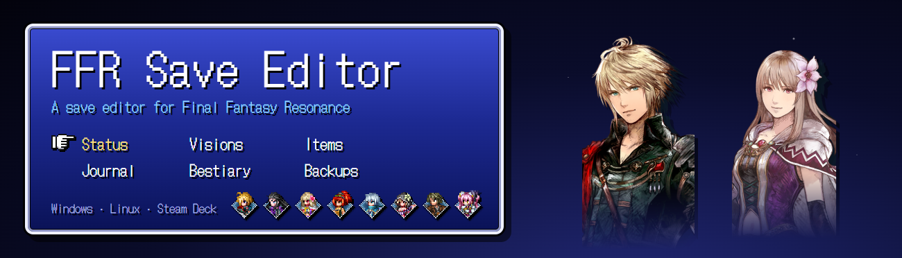
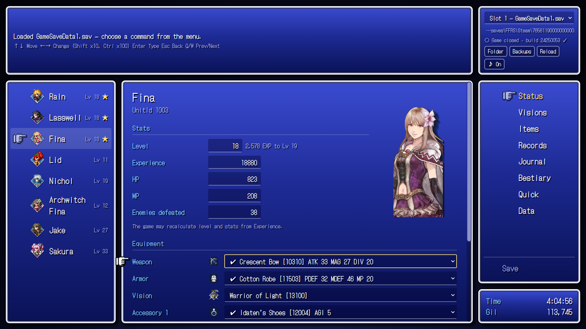
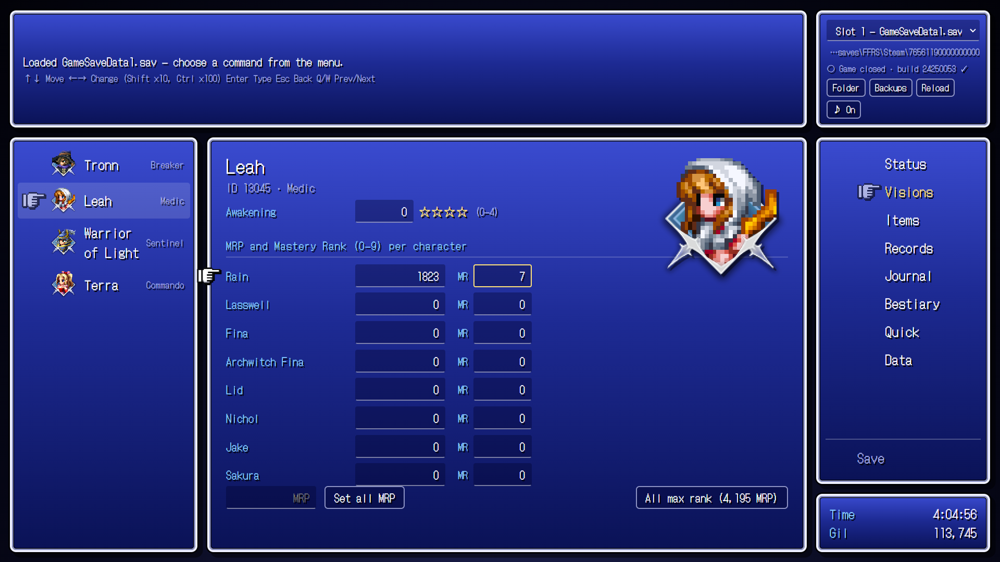
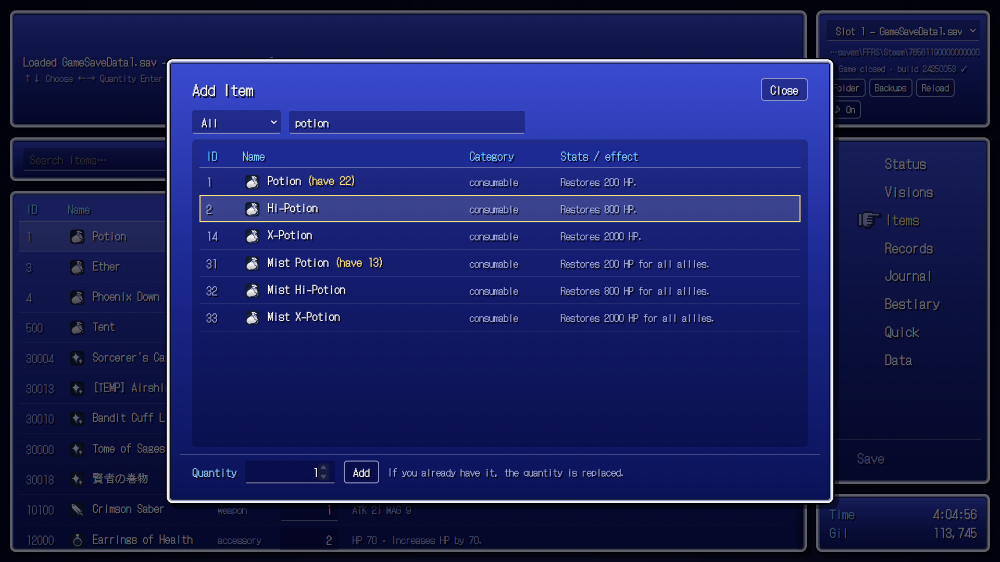
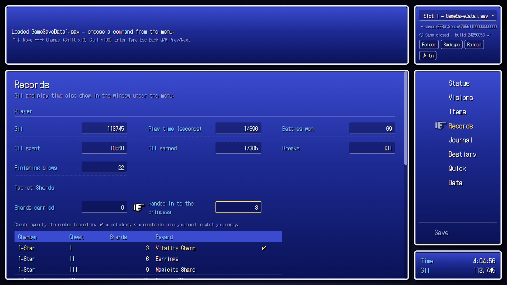
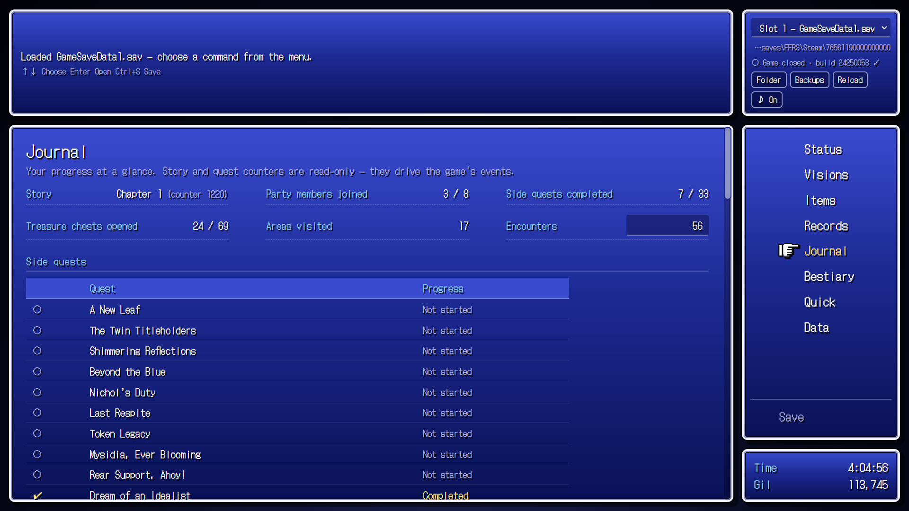
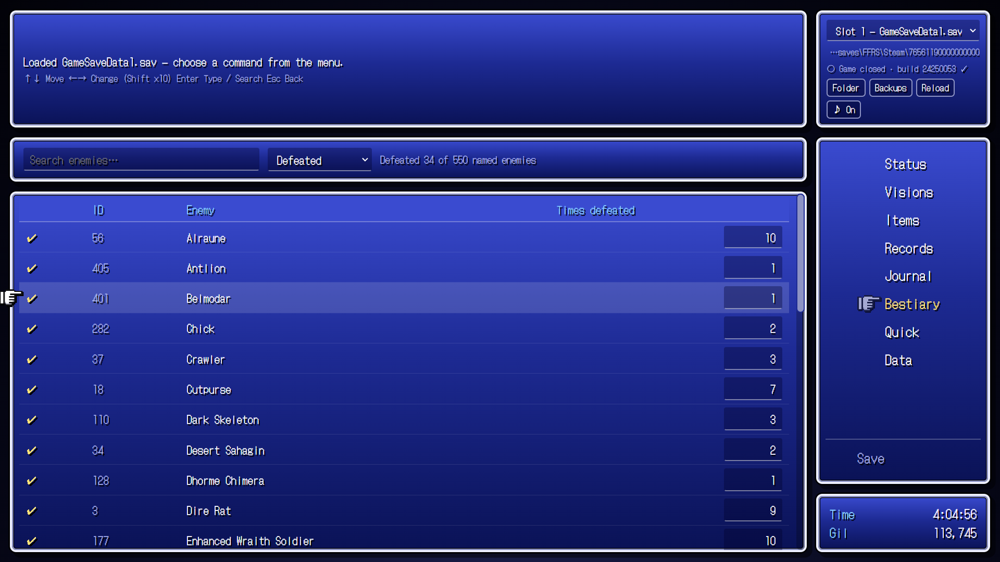

# FFR Save Editor

A save editor for **Final Fantasy Resonance** (Steam), with an interface in the style of the classic Final Fantasy menus. It runs on Windows, Linux and Steam Deck.



## Features

- **Status:** character level / EXP, HP and stats, and equipment chosen from dropdowns with icons.
- **Visions:** Mastery Rank, Awakening level and points.
- **Items:** edit quantities and add any item, including Tablet Shards (both carried and handed in).
- **Records, Journal, Bestiary:** quest progress, areas and enemies.
- **Quick actions** and your own saved presets (max level, max Gil, and so on).
- **Safety:**
  - saving is refused while the game is running;
  - a backup is made before every write;
  - a backup manager lets you restore older saves;
  - a warning appears when the game build hasn't been tested with the editor.
- **Save folder detection:** finds the folder automatically on Windows, Linux (Proton, including Flatpak and Snap Steam) and Steam Deck, or you can choose it yourself.
- **Keyboard control:** arrow keys, Enter and Esc, as in the games.

## Screenshots

| | |
|---|---|
|  |  |
|  |  |
|  |  |

## Download

Ready-to-run builds are on [Nexus Mods](https://www.nexusmods.com/) and in this repo's Releases.

## Running from source

Requires [Node.js](https://nodejs.org/) 20 or newer.

```sh
npm install
npm start        # run the editor
npm test         # run the tests (pass a save to test against: npm test -- path/to/GameSaveData1.sav)
npm run dist     # build the Windows portable/zip and the Linux AppImage/tar.gz into dist/
```

## Save format

The saves live at `%LOCALAPPDATA%\FFRS\Steam\<SteamID>\GameSaveData<N>.sav` on Windows (slot 0 is the autosave). On Linux and Steam Deck they're in the same place inside the Proton prefix: `steamapps/compatdata/3259780/pfx/drive_c/users/steamuser/AppData/Local/FFRS/Steam/<SteamID>`.

Each file has a 32-byte header followed by an encrypted body:

- **Header:** `SVHD`, two 16-bit version fields, then the SHA-1 of the body, then four zero bytes.
- **Body:** encrypted with AES-256-ECB. Decrypted, it's an Unreal Engine 5 GVAS save game using the UE 5.5+ property tag format.

See `src/main/save-crypto.js` and `src/shared/ffrs-save.js` for the details.

## Disclaimer

This is an unofficial fan tool. It isn't affiliated with or endorsed by Square Enix. Always keep a backup of your saves.

## License

The source code is [MIT](LICENSE). Game content in `data/` belongs to Square Enix. For third-party credits, see [THIRD-PARTY-NOTICES.txt](THIRD-PARTY-NOTICES.txt).
